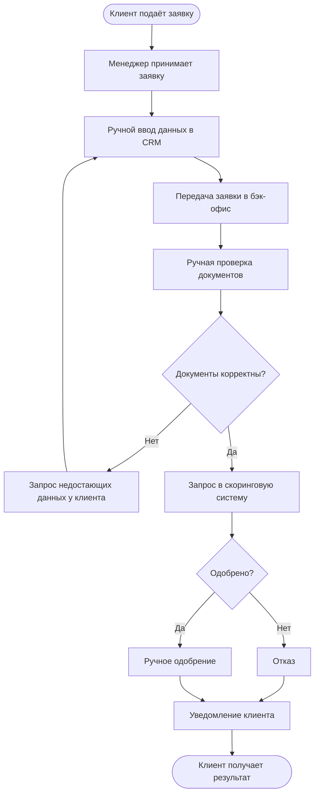

# As-Is: текущий процесс подключения клиента

Срок подключения — **до 2 рабочих дней**.

Процесс последовательный: заявка «ходит» между менеджером и бэк-офисом, данные вводятся вручную, статус обновляется вручную.

## Узкие места

- ручной ввод и повторный ввод данных в нескольких системах;
- заявка последовательно передаётся между менеджером и бэк-офисом;
- ручная проверка документов и ручное обновление статуса;
- отсутствие прозрачности: клиент и менеджер не видят текущий статус;
- высокая нагрузка на сотрудников и риск ошибок.
