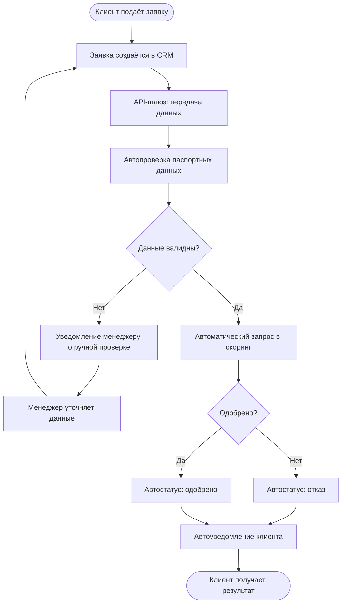

# To-Be: оптимизированный процесс подключения клиента

Целевой срок — **до 30 минут**.

Ключевые изменения: автопроверка данных, единый статус заявки, автоматическое уведомление клиента, ручные операции — только для исключений.

## Эффект

- срок подключения сокращается с 2 рабочих дней до 30 минут;
- исключён повторный ввод данных;
- единый статус заявки и история изменений;
- ручная проверка — только для исключительных случаев (FR-004);
- снижение нагрузки на сотрудников и количества ошибок.
