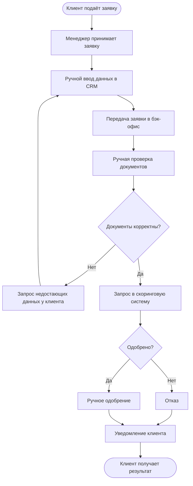
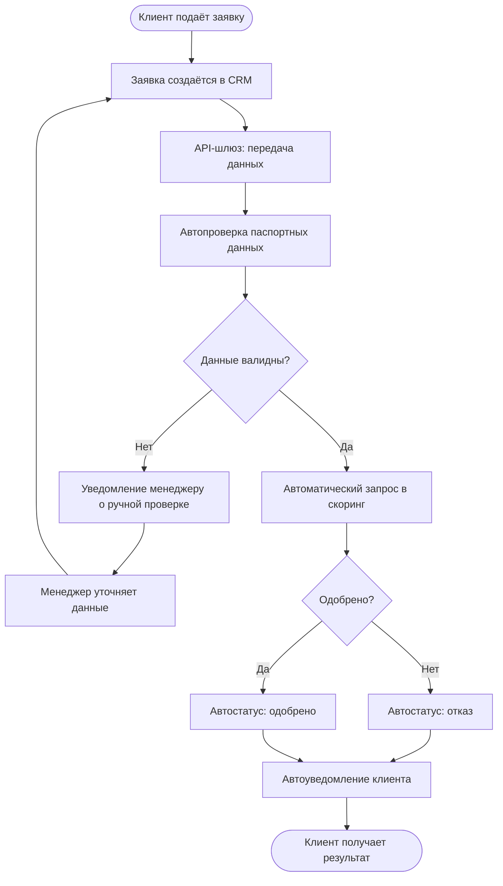

# Анализ процесса подключения клиента к банковскому продукту

Учебно-практический проект по системному и бизнес-анализу: разбор текущего процесса подключения клиента (**As-Is**), выявление узких мест и проектирование оптимизированного процесса (**To-Be**) с описанием требований, API и работы с данными.

**Цель** — сократить срок подключения клиента с 2 рабочих дней до 30 минут, снизить долю ручных операций и повысить прозрачность процесса.

## Проблема (As-Is)

Процесс последовательный: заявка передаётся между менеджером и бэк-офисом, данные вводятся вручную, статус обновляется вручную.



## Решение (To-Be)

Автопроверка данных, единый статус заявки, автоматическое уведомление клиента; ручные операции — только для исключений.



## Артефакты

- [As-Is: текущий процесс](Docs/as-is.md)
- [To-Be: оптимизированный процесс](Docs/to-be.md)
- [Бизнес-требования](Docs/business-requirements.md)
- [Функциональные требования](Docs/functional-requirements.md)
- [API-спецификация](Docs/api-specification.md)
- [Пример SQL-запроса](Docs/sql-example.sql)

## Инструменты

BPMN · SQL · REST API · Business Analysis · System Analysis

## Структура

```
bank-client-onboarding-analysis/
 ├── README.md
 └── Docs/
      ├── as-is.md
      ├── to-be.md
      ├── business-requirements.md
      ├── functional-requirements.md
      ├── api-specification.md
      └── sql-example.sql
```

## Что демонстрирует проект

- системный и бизнес-анализ;
- моделирование процессов (As-Is / To-Be);
- описание требований;
- проектирование интеграции (API);
- работу с данными (SQL).
